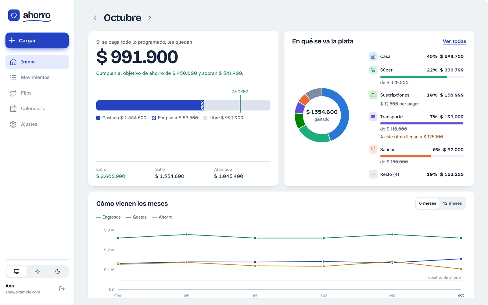
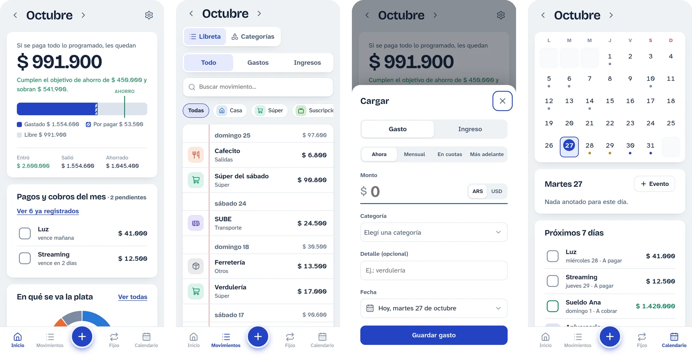
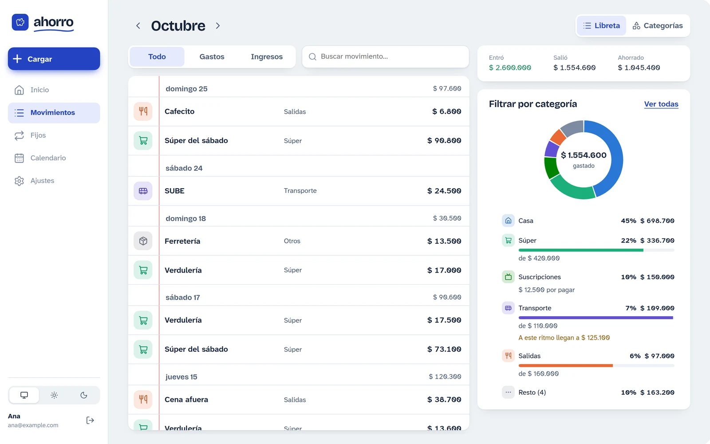
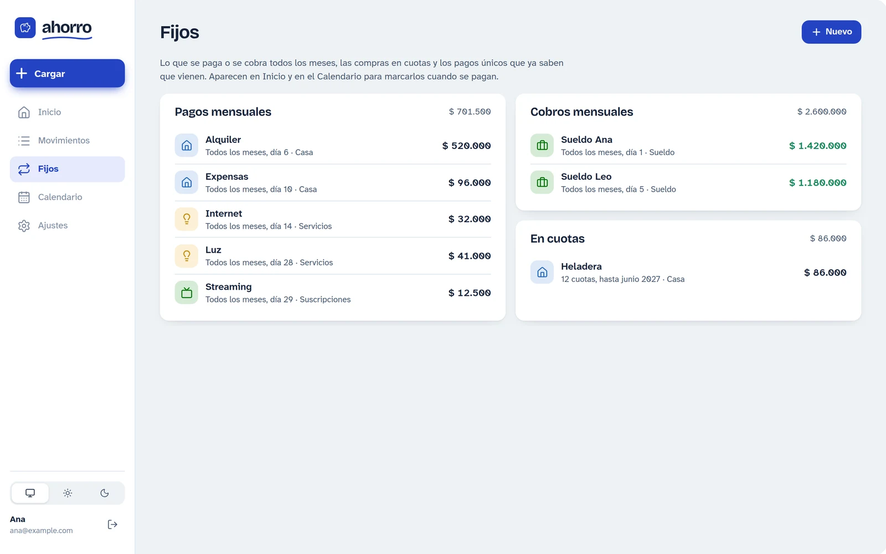
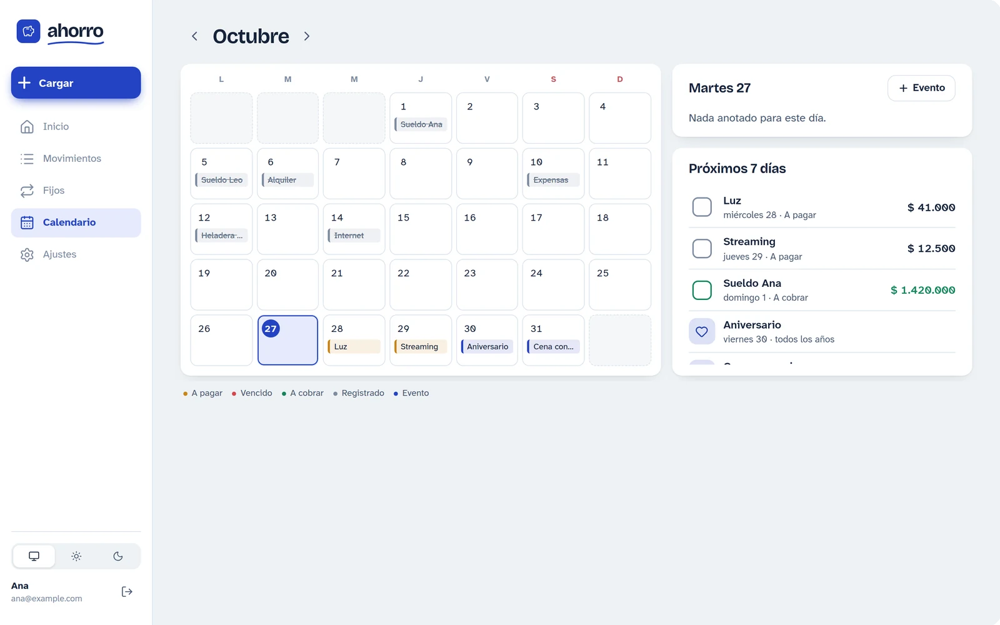

# Ahorro

> **Versión** 2.5.1 · **Última actualización** 2026-10-27 · [Desarrollo, deploy e historial de versiones](docs/DESARROLLO.md)

Libreta compartida de la casa para dos personas: gastos del día a día, ingresos, pagos fijos y en cuotas, calendario de vencimientos y un objetivo de ahorro mensual. La hice para usarla en pareja: la cargamos desde el celular en el momento y la miramos con calma en la compu.

<picture>
  <source media="(prefers-color-scheme: dark)" srcset="docs/capturas/escritorio-inicio-oscuro.webp">
  
</picture>

<picture>
  <source media="(prefers-color-scheme: dark)" srcset="docs/capturas/celular-oscuro.webp">
  
</picture>

Las capturas usan datos inventados. Siguen el tema claro u oscuro de GitHub, igual que la app sigue el del dispositivo.

## Qué hace

- **Inicio**: cuánto les queda en el mes si se paga todo lo programado, contra el objetivo de ahorro. La barra muestra lo gastado, lo comprometido sin pagar (rayado) y la marca del objetivo. Debajo, los pagos y cobros pendientes (se marcan con un toque), la torta con el reparto del gasto contra el presupuesto de cada categoría (y el aviso «A este ritmo llegan a…» cuando una va a pasarse) y las líneas de ingresos, gastos y ahorro de los últimos 6 o 12 meses. En la primera quincena, una tarjeta con el cierre del mes anterior.
- **Cargar** (botón +): un solo formulario para todo. «Ahora» registra un movimiento; «Mensual», «En cuotas» y «Más adelante» lo programan (un pago en cuotas es un mensual que termina solo). La categoría se elige de un desplegable con su ícono y color, y la fecha o el día del mes de un almanaque. Recuerda la última categoría usada; admite pesos o dólares (se pasan a pesos con el blue del día o con la cotización que se cargue).
- **Movimientos**: la libreta del mes, por día; tocar un renglón lo edita o lo borra. La pestaña Categorías da de alta, edita (ícono, color, presupuesto), archiva o borra categorías. En escritorio, al costado, los números del mes y la torta para filtrar por categoría.
- **Fijos**: alquiler, expensas, servicios, sueldos (todos los meses, un día dado), compras en cuotas y pagos únicos con fecha, con el mismo formulario que la carga. Al registrarlos se carga el monto real.
- **Calendario**: vencimientos del mes (a pagar, vencidos, a cobrar, registrados), eventos propios (cumpleaños y aniversarios anuales, salidas, recordatorios) y los de otros calendarios conectados. En escritorio cada día muestra sus nombres; debajo del día elegido, lo que viene en los próximos 7 días.
- **Ajustes**: objetivo de ahorro mensual (en pesos o dólares), cotización del blue y copia de seguridad. El tema (claro, oscuro o el del sistema) y la cuenta están al pie de la barra lateral en escritorio y en Ajustes en el celular.

En escritorio ninguna sección desplaza la página: cada columna (y la libreta, los pagos del mes y las listas largas) se desplaza por su cuenta.

### Calendarios (desactivados)

Están apagados con `CALENDARIOS_CONECTADOS_HABILITADOS` en `frontend/src/config/features.js`; el backend sigue respondiendo.

- **De la app al teléfono**: `GET /api/calendario.ics?clave=…` publica los vencimientos (del mes anterior a 12 meses adelante, con aviso el día previo a las 9) y los eventos. No pide sesión porque los calendarios no mandan tokens: lo protege la clave, derivada de `SECRET_KEY` (cambiarla invalida el enlace). En Ajustes están «Suscribirme» (`webcal://`, para iPhone) y «Copiar enlace» (Google Calendar → Otros calendarios → Desde URL).
- **De Google (u otro) a la app**: en Ajustes se agrega la «Dirección secreta en formato iCal» del calendario. El backend la descarga, la guarda en memoria `CALENDARIO_EXTERNO_MINUTOS` y suma sus eventos (con las repeticiones, en la `ZONA_HORARIA`) al Calendario de la app. Si no responde, el mes se ve igual y avisa qué calendario faltó. La dirección completa no vuelve a mostrarse, solo su dominio.

Las dos cuentas comparten todos los datos. El registro queda abierto hasta que existen 2 cuentas (`MAX_USUARIOS`) y después se cierra solo.

<strong>Más pantallas de escritorio</strong>

<picture>
  <source media="(prefers-color-scheme: dark)" srcset="docs/capturas/escritorio-movimientos-oscuro.webp">
  
</picture>

<picture>
  <source media="(prefers-color-scheme: dark)" srcset="docs/capturas/escritorio-fijos-oscuro.webp">
  
</picture>

<picture>
  <source media="(prefers-color-scheme: dark)" srcset="docs/capturas/escritorio-calendario-oscuro.webp">
  
</picture>

## Decisiones técnicas

- **Un solo servicio.** FastAPI sirve la API bajo `/api` y el build de React en el resto de las rutas: un deploy, un dominio y sin CORS.
- **SQLite en un volumen**, sin servidor de base de datos ni migraciones: para dos personas alcanza y sobra, y la copia de seguridad es un archivo (`VACUUM INTO`, consistente aunque haya escrituras en curso).
- **Montos en centavos enteros** para no arrastrar errores de punto flotante. Los gastos en dólares guardan la cotización usada; el blue se consulta en [dolarapi.com](https://dolarapi.com) y se guarda 6 h, así la app sigue andando si la API externa se cae.
- **Backend en capas:** routers delgados, servicios con las reglas y excepciones de dominio que se traducen a HTTP en un solo lugar. Los servicios externos se inyectan, así los tests los reemplazan por dobles.
- **Pagos programados como reglas, no como filas por mes:** un fijo mensual o en cuotas genera sus vencimientos al consultar cada mes, y al pagarlo se registra el monto real.
- **Interfaz sin librería de componentes:** CSS propio con una escala de espacios y tokens de color para el tema claro y el oscuro, gráficos en SVG a mano (torta y líneas, con su tabla alternativa), atajos de teclado y diálogos nativos (`<dialog>`). Se instala como app en el teléfono.

## Stack

FastAPI, SQLAlchemy 2, Pydantic 2 y SQLite con `uv` en el backend; React 19 y Vite en el frontend; un solo contenedor en Railway. Cómo levantarla en local, configurarla y desplegarla está en [docs/DESARROLLO.md](docs/DESARROLLO.md).

## Licencia

[MIT](LICENSE).
